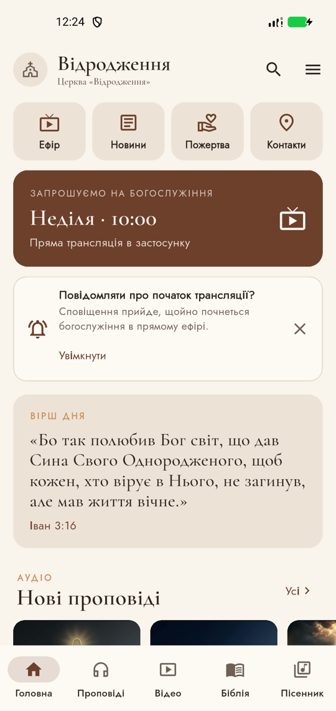
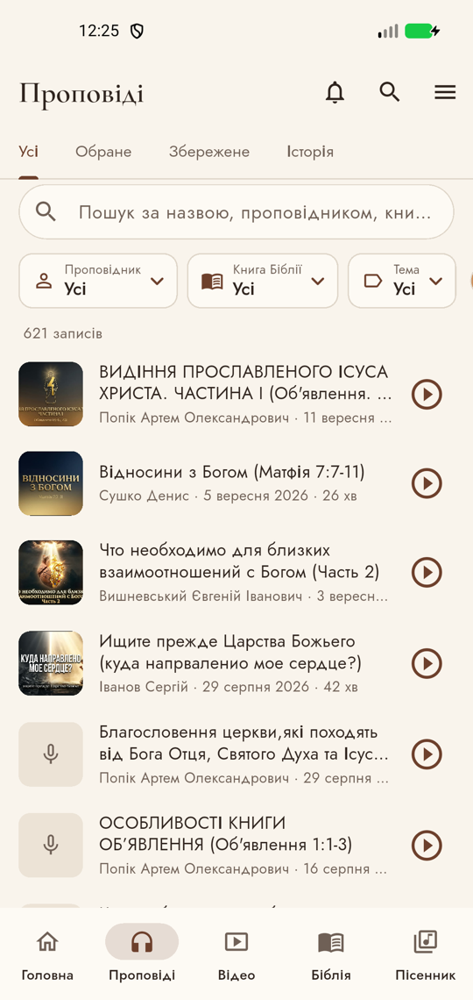
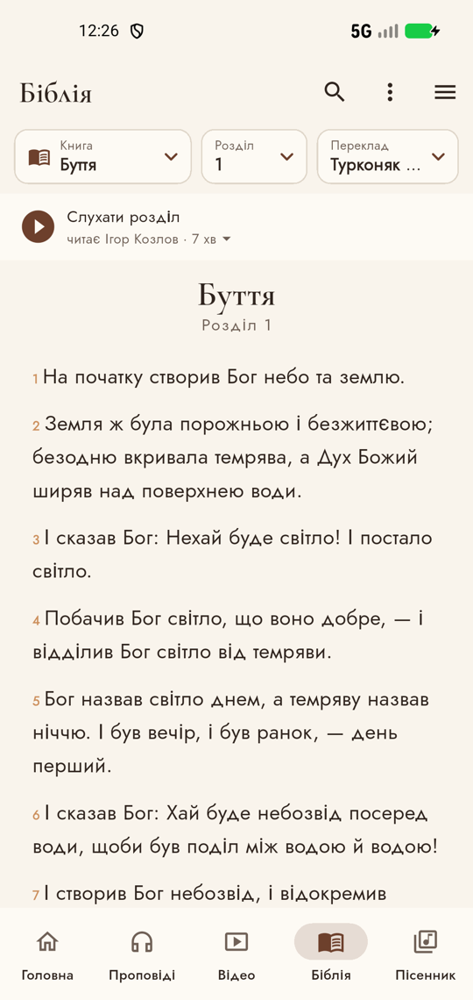
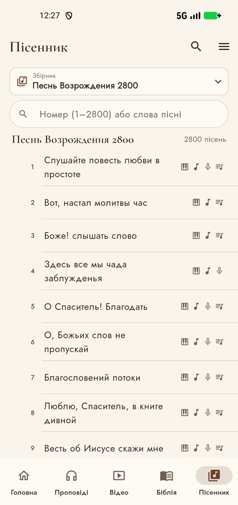
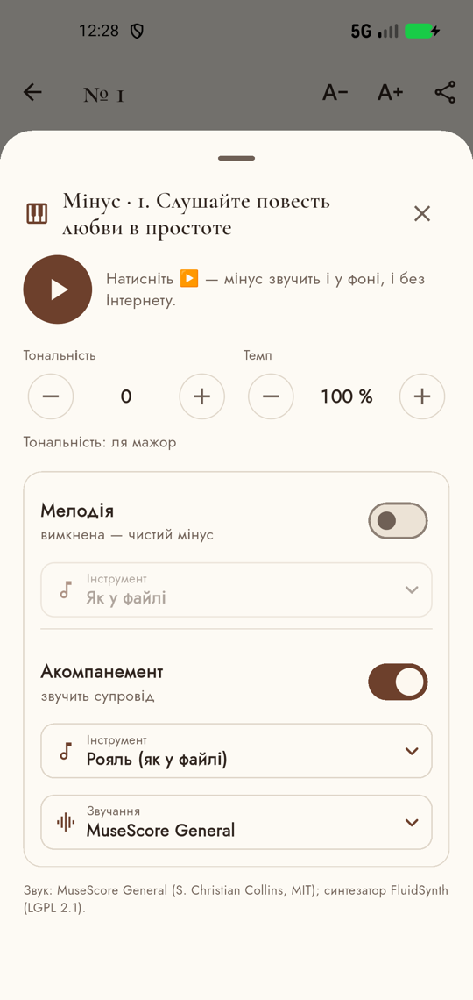

# Vidrodzhennia church app — Bible, sermons, songbook and live stream (Android, Flutter)

🇺🇦 [Українська](README.md) · 🇬🇧 **English**

A free Android app that puts everything a church member needs in one phone: **sermon audio (plays in the background and works
offline), the Bible with parallel translations and commentaries, a songbook with sheet music and a built-in "minus-track"
synthesizer, the live stream, news, and search across it all**. Written in Flutter, open source (MIT), and it **updates itself
from this repository**.

> The app reads its content from the church website [baptist.com.ua](https://baptist.com.ua): a new sermon, news item or song
> added in the site's admin panel shows up in the app on its own. To build a similar app for your own church, see the
> [full guide](docs/ПОВНИЙ-ОПИС.md#як-зробити-застосунок-для-своєї-церкви) (Ukrainian) and the [API reference](docs/API.md).

| Home | Sermons | Bible | Songbook | Minus-track |
|:--:|:--:|:--:|:--:|:--:|
|  |  |  |  |  |

The app's interface is in **Ukrainian, Russian and English** (the app follows the phone's language; Ukrainian and Russian phones get
Ukrainian, everything else gets English; you can choose manually in the menu). The detailed guide is written in Ukrainian.

## Install

1. On an Android 7.0+ phone open the [**latest release**](../../releases/latest) and download `vidrodzhennia-X.Y.Z.apk`.
2. Open the file. Android will ask you to allow installing from this source ("Install unknown apps") — allow it for the browser or
   file manager you used.
3. If Google Play Protect asks to scan the app, that is the usual non-Play check; continue.
4. Done. From now on the app offers updates by itself.

All releases are signed with one key (SHA-256 fingerprint `7E:04:96:10:…:9D:73`; full value in the
[guide](docs/ПОВНИЙ-ОПИС.md#перевірка-підпису)). An update installs over an older version only if it is signed with the same key.

## Features

| Section | What is inside |
| --- | --- |
| **Home** | live stream or an invitation to the service with its schedule, verse of the day, "continue listening", new sermons and videos, news, tiles Live / News / Donate / Contacts |
| **Sermons** | the whole archive (hundreds of recordings) on the phone: search, preacher, Bible book, topic; favourites, **saved for offline**, history; audio plays in the background and on the lock screen with notification controls, speed, **sleep timer**, resume where you stopped |
| **Videos** | latest from the channel, series, preachers, Bible-book studies; the official YouTube player plus "Listen as audio" (our own audio plays in the background) |
| **Bible** | book, chapter, translation; **parallel translation**; audio with the current verse highlighted (it keeps reading on its own); commentaries, dictionaries, search by words and references |
| **Songbook** | whole songbooks stored on the phone — **search by number or words works offline**; big lyrics, swipe between songs, full-screen sheet music, recordings; a **minus-track played by an on-device synthesizer** (FluidSynth): transpose ±6, tempo 50–150 %, melody/accompaniment on or off, instrument, karaoke lyrics |
| **Sheet music** | the site's "Notes" section: hymns from open sources, search, collections, page viewer |
| **Search** | one box for everything: songs, sermons, videos, news and articles |
| **Notifications** | live-stream start and new content (news, videos, sermons) — separate switches |
| **Menu** | language, light/dark theme, donations (payment happens on the site's page — the app never sees card data), contacts, check for updates, source code and licenses |

Works with the phone's **large font setting** (checked up to 200 %). Launcher shortcuts: Songbook, Bible, Live, Search.

## Updates

On every launch the app asks **GitHub** (`releases/latest` of this repository), shows what's new, downloads the file and opens the
installer (Android always asks the user to confirm). If GitHub cannot be reached, it asks the church website, which serves the same
releases, as a fallback. Copies older than 1.0.15 keep updating too: their address on the website now points to this repository's releases.

## Build from source

```sh
flutter pub get
flutter test
flutter build apk --release --target-platform android-arm,android-arm64
```

Requires Flutter 3.47+ (Dart 3.13), JDK 17 and the Android SDK. `scripts/build-android.sh` (disk guard, version from `pubspec.yaml`) and
`scripts/release-android.sh` (build, signature check, GitHub release) work on macOS and Linux; on Windows use the command above.

**The signing key is not in the repository.** Point `CHURCH_APP_KEY_DIR` (default `~/.church-app-key`) at a folder with `key.properties`
and, optionally, `google-services.json` (Firebase, for instant push; without it the app falls back to alarms; in the published 1.0.13–1.0.15 builds FCM is not enabled in the APK — see [limitations](docs/ПОВНИЙ-ОПИС.md#обмеження-й-відомі-особливості)). Without a key the build is
signed with the debug key — fine for your own phone, but it will not accept GitHub updates. Lose the key and every installed copy
stops updating: keep a separate backup.

## Make one for your church

The app reads the site API (`/api/app/v1/*`, described in [docs/API.md](docs/API.md)). To adapt: set your site address in
`lib/api/api.dart` and the Kotlin files, change `applicationId` and the icon, point updates at your repository
(`--dart-define=UPDATE_REPO=owner/repo`) and sign with your own key. Step by step: [guide](docs/ПОВНИЙ-ОПИС.md#як-зробити-застосунок-для-своєї-церкви) (Ukrainian).

## Limitations

- **Android 7.0+** only (ARM). There is iOS code, but no iOS build or distribution yet.
- Built for installation from a file, **not for Google Play**: Play forbids apps that update themselves outside the store.
- YouTube video does not play in the background (YouTube's rules); use "Listen as audio" instead.
- Sermons, Bible, songbook and sheet music need the source website; after the first download they work offline.

## Documentation

- [Full guide](docs/ПОВНИЙ-ОПИС.md) ([PDF](docs/ПОВНИЙ-ОПИС.pdf)) — Ukrainian: what it is, what it is for, scenarios, every feature, how it works,
  install, update, build, limits;
- [Site API](docs/API.md);
- [Third-party components](THIRD_PARTY.md) · [FluidSynth in the app](third_party/fluidsynth/README.md).

License: [MIT](LICENSE). Author: [roman885-85](https://github.com/roman885-85).
