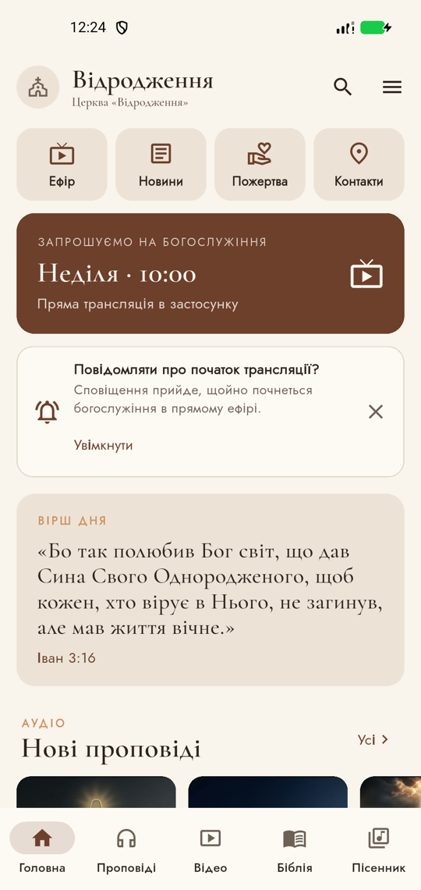
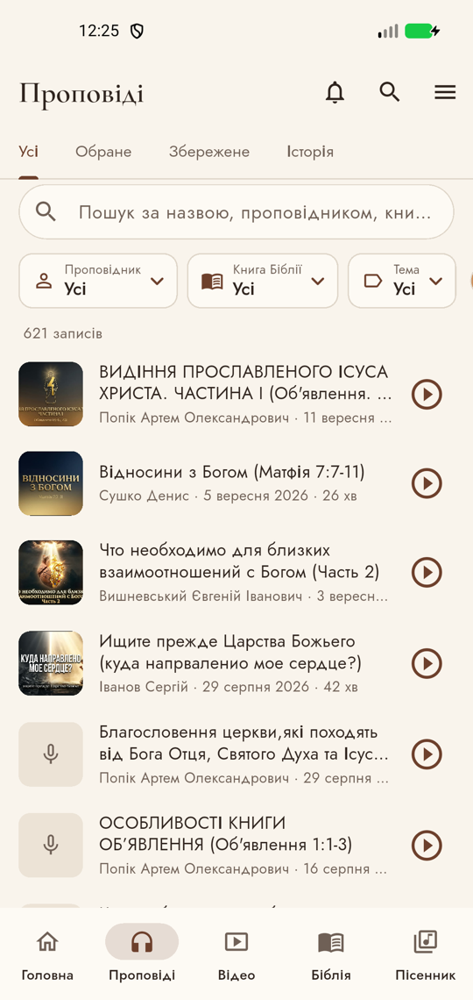
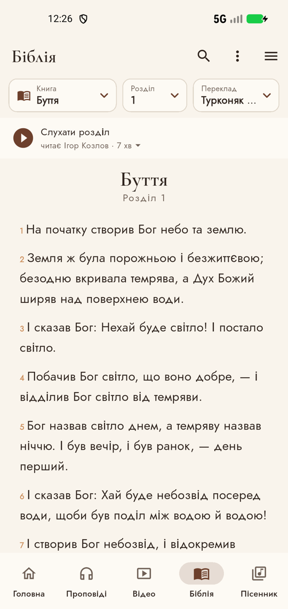
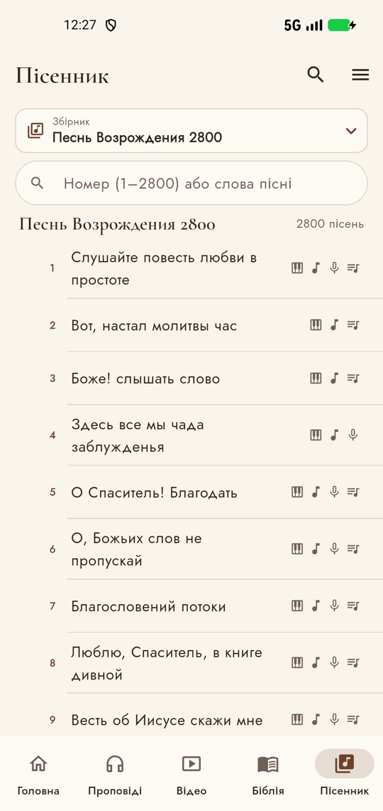
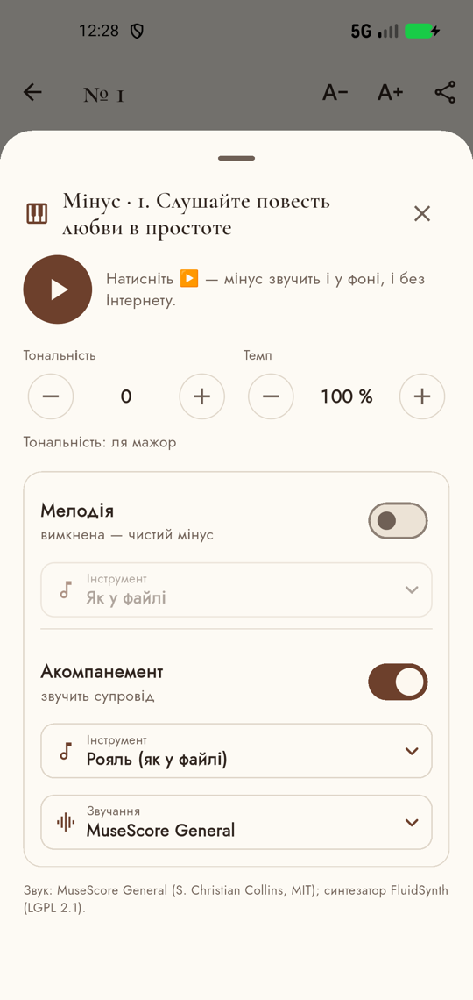

# Застосунок церкви «Відродження» — Біблія, проповіді, пісенник і ефір (Android, Flutter)

🇺🇦 **Українська** · 🇬🇧 [English](README.en.md)

Безкоштовний застосунок для Android, який збирає в телефоні все, що потрібно людині з церкви: **проповіді звуком (у фоні, без
інтернету), Біблію з паралельним перекладом і коментарями, пісенник із нотами та «мінусом», прямий ефір, новини, пошук по
всьому**. Код на Flutter, відкритий (MIT). Оновлюється сам — з цього репозиторію.

> Застосунок працює з сайтом церкви [baptist.com.ua](https://baptist.com.ua): нова проповідь, новина чи пісня в адмінці сайту
> з'являється в застосунку сама. Як зробити такий для своєї церкви — у [повному описі](docs/ПОВНИЙ-ОПИС.md#як-зробити-застосунок-для-своєї-церкви).

| Головна | Проповіді | Біблія | Пісенник | Мінус пісні |
|:--:|:--:|:--:|:--:|:--:|
|  |  |  |  |  |

## Встановити

1. На телефоні з Android 7.0 і новішим відкрийте [**останній випуск**](../../releases/latest) і завантажте файл
   `vidrodzhennia-X.Y.Z.apk`.
2. Відкрийте файл. Android попросить дозволити встановлення з цього джерела («Встановлення невідомих застосунків») —
   дозвольте для браузера чи файлового менеджера, яким відкрили файл.
3. Якщо Google Play Protect запитає про перевірку — це звичайна перевірка не з Play; продовжуйте.
4. Готово. Далі застосунок сам запропонує оновлення.

Справжність файла: усі випуски підписані одним ключем, його відбиток SHA-256 —
`7E:04:96:10:…:9D:73` (повний — у [повному описі](docs/ПОВНИЙ-ОПИС.md#перевірка-підпису)). Оновлення поверх старої версії
встановлюється лише з тим самим ключем.

## Що вміє

| Розділ | Що всередині |
| --- | --- |
| **Головна** | прямий ефір або запрошення на богослужіння з розкладом, вірш дня, «продовжити слухати», нові проповіді й відео, новини, плитки «Ефір / Новини / Пожертва / Контакти» |
| **Проповіді** | вся фонотека (сотні записів) на телефоні: пошук, проповідник, книга Біблії, тема; обране, **збережене для офлайну**, історія; звук грає у фоні, на заблокованому екрані, з кнопками в сповіщенні, швидкість, **таймер сну**, «продовжити з місця» |
| **Відео** | нові з каналу, серії, проповідники, вивчення книг Біблії; офіційний плеєр YouTube + кнопка «Слухати звуком» (у фоні грає наше аудіо) |
| **Біблія** | книга, розділ, переклад; **паралельний переклад**; аудіо з підсвічуванням вірша (далі читає сама); коментарі, словники, пошук за словами й посиланнями |
| **Пісенник** | збірники цілком на телефоні — **пошук за номером або словами працює без інтернету**; слова крупно, гортання між піснями, ноти на весь екран, записи; **«мінус» власним синтезатором** (FluidSynth): тональність ±6, темп 50–150 %, вмикання й вимикання мелодії/акомпанементу, інструмент, слова-караоке |
| **Ноти** | розділ «Ноти» сайту: гімни з відкритих джерел, пошук, вибір збірки, перегляд сторінок |
| **Пошук** | один рядок на все: пісні, проповіді, відео, новини й статті |
| **Сповіщення** | про початок прямого ефіру і про нове (новини, відео, проповіді) — окремими перемикачами |
| **Меню** | мова (українська, російська, англійська; «як у телефоні»), світла/темна тема, пожертви (оплата на сторінці сайту — застосунок картки не бачить), контакти, перевірка оновлень |

Працює і з **великим шрифтом** телефона (перевірено до 200 %). Ярлики на значку: Пісенник, Біблія, Ефір, Пошук.

## Оновлення

Застосунок **сам перевіряє GitHub** (`releases/latest` цього репозиторію) при кожному запуску, показує, що нового, завантажує
файл і відкриває встановлення (Android завжди просить людину підтвердити). Якщо GitHub недоступний, запитує запасною дорогою
сайт церкви — він бере ті самі випуски. Копії до 1.0.15 теж оновлюються: їхня адреса на сайті тепер веде на випуски цього
репозиторію.

## Збірка з вихідного коду

```sh
flutter pub get
flutter test
flutter build apk --release --target-platform android-arm,android-arm64
```

Потрібні Flutter 3.47+ (Dart 3.13), JDK 17, Android SDK. Скрипти `scripts/build-android.sh` (збірка зі сторожем диска й версією з
`pubspec.yaml`) і `scripts/release-android.sh` (збірка, перевірка підпису, випуск на GitHub) — для macOS і Linux; на Windows —
командою вище. Докладно — [у повному описі](docs/ПОВНИЙ-ОПИС.md#збірка-з-вихідного-коду).

**Ключ підпису не в репозиторії.** Тека з ним — змінна `CHURCH_APP_KEY_DIR` (типово `~/.church-app-key`): у ній `key.properties`
і за потреби `google-services.json` (Firebase для миттєвих сповіщень; без нього застосунок працює на будильниках; у готових випусках 1.0.13–1.0.15 FCM у APK не вмикається — див. [«Обмеження»](docs/ПОВНИЙ-ОПИС.md#обмеження-й-відомі-особливості)). Без ключа збірка
підписується debug-ключем — для перевірки на своєму телефоні, оновлень з GitHub така копія не прийме. Загублений ключ = усі
встановлені копії перестають оновлюватися: зберігайте його окремо.

## Для своєї церкви

Застосунок читає дані з API сайту (`/api/app/v1/*`, опис — [docs/API.md](docs/API.md)). Щоб зробити свій: поставте свою адресу сайту в
`lib/api/api.dart` і Kotlin-файлах, змініть `applicationId` та іконку, вкажіть свій репозиторій оновлень
(`--dart-define=UPDATE_REPO=власник/репозиторій`) і підпишіть своїм ключем. Покроково — [у повному описі](docs/ПОВНИЙ-ОПИС.md#як-зробити-застосунок-для-своєї-церкви).

## Обмеження

- Лише **Android 7.0+** (ARM). Код для iPhone є, але збірки й розповсюдження поки немає.
- Зібраний для встановлення з файла, **не для Google Play**: Play забороняє застосункам оновлювати себе в обхід магазину.
- Відео YouTube не грає у фоні (правило YouTube); для фону — «Слухати звуком».
- Для самих проповідей, Біблії, пісенника й нот потрібен сайт-джерело; після першого завантаження вони працюють без мережі.

## Документація

- [Повний опис](docs/ПОВНИЙ-ОПИС.md) ([PDF](docs/ПОВНИЙ-ОПИС.pdf)) — що це, для чого, сценарії, усі функції, як працює, встановлення,
  оновлення, збірка, обмеження;
- [API сайту](docs/API.md);
- [Сторонні компоненти](THIRD_PARTY.md) · [FluidSynth у застосунку](third_party/fluidsynth/README.md).

Ліцензія: [MIT](LICENSE). Автор — [roman885-85](https://github.com/roman885-85).
