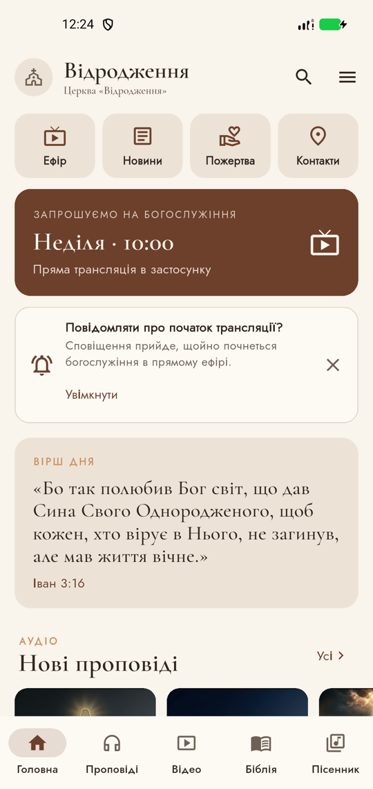
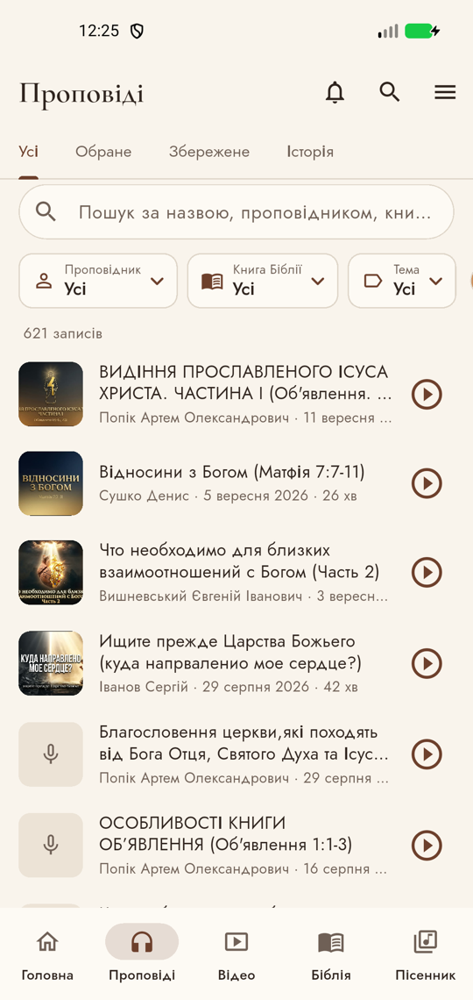
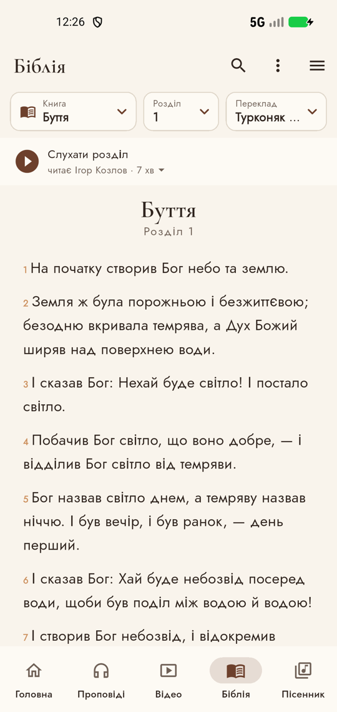
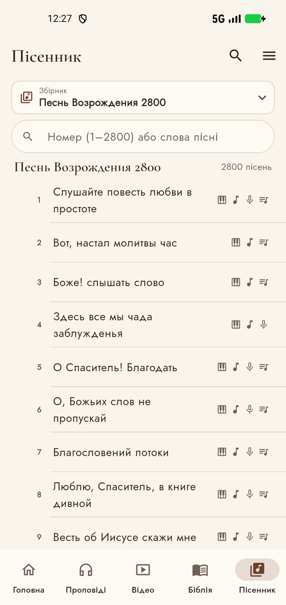
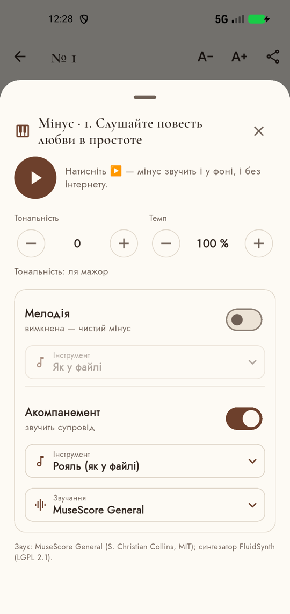

# Застосунок церкви «Відродження» — повний опис

Версія документа: 1.0.15 · листопад 2026 · Android 7.0+ · Flutter · ліцензія MIT

Репозиторій: <https://github.com/roman885-85/church-app-flutter-bible-sermons-songbook> ·
Останній випуск: <https://github.com/roman885-85/church-app-flutter-bible-sermons-songbook/releases/latest>

## Зміст

1. Що це
2. Для чого це може придатися
3. Усі можливості
4. Як це працює
5. Встановлення
6. Перевірка підпису
7. Оновлення
8. Дозволи й приватність
9. Збірка з вихідного коду
10. Випуск оновлення (для того, хто веде проєкт)
11. Як зробити застосунок для своєї церкви
12. Обмеження й відомі особливості
13. Що де лежить у репозиторії
14. Ліцензії

## Що це

Мобільний застосунок церкви «Відродження» (Дніпро) для телефонів і планшетів на Android. Це «церква в кишені»: усе, що
людині потрібно між недільними богослужіннями й під час них, — в одному місці, швидко, **без реєстрації і без реклами**:

- слухати **проповіді** звуком — у фоні, на заблокованому екрані, у дорозі й без інтернету;
- читати **Біблію** (кілька перекладів, паралельний переклад, коментарі, словники) і слухати її аудіо з підсвічуванням вірша;
- знайти й показати **пісню** з пісенника: слова крупно, ноти, «мінус» із можливістю змінити тональність і темп;
- дивитися **прямий ефір** богослужіння й записи на YouTube;
- читати **новини** церкви й отримувати **сповіщення**: «починається трансляція», «нова проповідь»;
- шукати одним рядком по всьому.

Застосунок — «тонкий клієнт» до сайту церкви [baptist.com.ua](https://baptist.com.ua): усе, що люди бачать, редагується в адмінці
сайту, і воно з'являється в застосунку само. Тому застосунок не треба випускати наново, щоб додати проповідь чи пісню; новий випуск
потрібен лише тоді, коли змінюється сам застосунок.

Код написаний на Flutter (Dart) з невеликою частиною на Kotlin (сповіщення, будильники) і готовими бібліотеками FluidSynth для
звуку мінусів. Відкритий за ліцензією MIT: його можна читати, перевіряти, змінювати й робити з нього застосунок для своєї
церкви (розділ 11).

| Головна | Проповіді | Біблія | Пісенник | Мінус пісні |
|:--:|:--:|:--:|:--:|:--:|
|  |  |  |  |  |

*Знімки зроблено з версії 1.0.15 на емуляторі Android; дані — з сайту церкви.*

## Для чого це може придатися

**Звичайна людина в церкві**

- *У дорозі чи за роботою.* Увімкнути проповідь, заблокувати екран — звук іде далі; кнопки паузи й перемотки — у сповіщенні й на
  екрані блокування. Таймер сну вимкне запис, коли людина засне. «Продовжити з місця» повертає на ту хвилину, де зупинилися.
- *Без інтернету.* Проповіді можна зберегти на телефон (кнопка «Завантажити»); пісенник лежить на телефоні цілком — пісня
  знаходиться за номером чи словами і в підвалі церкви, де зв'язку немає.
- *Не пропустити ефір.* Перемикач «Прямі трансляції» сповістить, коли починається богослужіння; на головній видно розклад.
- *Біблія для вивчення.* Паралельний переклад (наприклад, український і англійський поруч), аудіо з підсвічуванням вірша,
  коментарі й словникові статті; пошук за словом чи посиланням («Івана 3:16»).
- *Людям з вадами зору й старшим.* Застосунок підлаштовується під великий шрифт телефона (перевірено до 200 %), має світлу й темну тему.

**Служителі й музиканти**

- *Спів на богослужінні чи в домашній групі.* Відкрити пісню в пісеннику, увімкнути «мінус»: можна підняти чи опустити тональність
  на ±6 півтонів, змінити темп від 50 до 150 %, вимкнути мелодію (щоб співали люди) або акомпанемент (щоб грав музикант), вибрати
  інструмент, дивитися слова-караоке. Без інтернету теж, після першого завантаження звуку.
- *Ноти.* Розділ «Ноти» — гімни з відкритих джерел, перегляд сторінок і завантаження оригінальних файлів.
- *Роздати посилання.* «Поділитися» на пісні чи проповіді відправляє посилання на сторінку сайту.

**Церкви й спільноти, які хочуть власний застосунок**

- Готовий приклад повного застосунку для церкви: усі розділи, офлайн, сповіщення, самооновлення, три мови. Замініть адресу сайту,
  назву, іконку й ключ — і маєте свій (розділ 11). Якщо у вас інший сайт, достатньо віддавати ті самі відповіді JSON ([API](API.md)).

**Розробники**

- Приклад, як у Flutter зібрати: фонове аудіо з екраном блокування (`just_audio_background`), **FluidSynth через `dart:ffi`** з
  відтворенням, що зразу пишеться у WAV (швидше, ніж грає), офлайн-кеш відповідей, точні будильники й `JobScheduler` на Kotlin,
  Firebase Cloud Messaging **без плагіна google-services**, самооновлення Android з GitHub (`ota_update`), три мови без генерації.

## Усі можливості

### Головна

- Червона картка **«Зараз наживо»**, коли йде трансляція; поза ефіром — запрошення на богослужіння з розкладом і картою.
- **Вірш дня**, «Продовжити слухати» (остання проповідь чи глава), нові проповіді й відео, свіжі новини.
- Чотири плитки: Ефір, Новини, Пожертва, Контакти.

### Проповіді

- Уся фонотека (сотні записів) лежить на телефоні, тож **пошук і фільтри працюють миттєво й без мережі**: за проповідником, книгою
  Біблії, темою, словами.
- Вкладки: Усі · Обране · Збережене без інтернету · Історія.
- Сторінка проповіді: опис, проповідник, схожі записи (того ж проповідника, з тієї ж книги), «Поділитися».
- Програвач: перемотка, швидкість, **таймер сну**, обране, «Завантажити для офлайну», міні-плеєр унизу на всіх екранах.
- Звук — наш mp3 із сервера церкви (а не відео YouTube), тому він **законно грає у фоні й на заблокованому екрані**.

### Відео

- Вкладки: нові з каналу · серії · проповідники · вивчення книг Біблії.
- Відео — **офіційним плеєром YouTube**; кнопка «Слухати звуком» вмикає той самий запис нашим аудіо у фоні. (Правила YouTube не
  дозволяють грати відео у фоні, тому при згортанні відео ставиться на паузу.)

### Біблія

- Книга, розділ і переклад — кнопками вгорі; безперервне читання з переходом до наступної глави.
- **Паралельний переклад**: два переклади в одному рядку.
- **Аудіо-Біблія** з підсвічуванням вірша; наприкінці глави читає наступну сама.
- Коментарі й словникові статті; посилання на вірші всередині коментарів відкривають потрібне місце в читанці.
- Пошук за словами в вибраному перекладі (наголоси не заважають) і за посиланнями.

### Пісенник

- Кілька збірників; кожен **завантажується на телефон цілком** (кілька мегабайт: «Пісні Відродження 2800» — 5,5 МБ) і тихо оновлюється, коли на сайті
  щось змінилося. Пошук за номером (Enter на номер відкриває пісню) або за словами — без інтернету.
- Пісня: слова крупно, куплети й приспіви, сусідні пісні — гортанням убік; ноти на весь екран; записи.
- **Мінус власним синтезатором** (FluidSynth 2.6, три звукові банки на вибір, у тому числі легкий — для повільного інтернету):
  мелодія й акомпанемент вмикаються окремо, інструмент, тональність ±6, темп 50–150 %, слова-караоке. Звук пишеться у файл швидше,
  ніж грає, і програвач читає його, поки той дописується; грає у фоні з кнопками в сповіщенні; два останні рендери кешуються.

### Ноти

- Розділ «Ноти» сайту: сотні творів, пошук, вибір збірки, перегляд сторінок (дотик — на весь екран), запис для прослуховування,
  оригінальні файли для завантаження. Якщо файл не показується в застосунку — відкривається на сайті.

### Пошук

- Один рядок угорі на кожному розділі: пісні (номер або слова), проповіді й відео — прямо на телефоні й без мережі; новини й статті —
  через сайт. Біблію шукає її власний пошук.

### Ефір і сповіщення

- Екран «Ефір»: поки трансляції немає — запрошення з розкладом; щойно починається — з'являється плеєр.
- **Сповіщення про початок ефіру** і **про нове** (новини/статті/фото, відео, проповіді) — окремі перемикачі в «Меню → Сповіщення»
  і дзвіночки в заголовках розділів. Одне нове — сповіщення веде просто на запис; кілька — «Нові відео (3)» і перехід у розділ.
- Працюють без акаунта й без реєстрації: усе вирішує сам телефон (будильники й планувальник Android), а в збірках з увімкненим Firebase —
  миттєво (у готових випусках поки що лише будильники — див. «Відомі особливості»).

### Меню

- Мова: **українська, російська, англійська**; «як у телефоні» (українські й російські телефони — українська, решта —
  англійська); можна вибрати вручну. Світла й темна тема.
- **Пожертви**: реквізити, QR і посилання; оплата — на сторінці сайту чи в банківському застосунку. Застосунок платежів не приймає
  і даних картки не бачить.
- Контакти й карта; сайт церкви.
- Перевірка оновлень, **відкритий код на GitHub**, ліцензії відкритого коду.
- Ярлики на значку застосунку (довгий натиск): Пісенник, Біблія, Ефір, Пошук.

## Як це працює

**Шари.** Інтерфейс — Flutter (Material 3, `provider`). Дані — клас `Api` (`lib/api/api.dart`) ходить на `https://baptist.com.ua/api/app/v1/*`
і **кожну вдалу відповідь кладе на диск**: коли мережі немає, показується те, що застосунок бачив востаннє, а не порожній екран.
Спільні дані (церква, фонотека, відео) оновлюються самі: при поверненні в застосунок і кожні 10 хвилин, поки він на екрані.

**Звук.** Проповіді й аудіо-Біблія — `just_audio` + `just_audio_background`: екран блокування, навушники, швидкість, таймер сну. Сервер
віддає mp3 частинами (`Range`), тож перемотка працює. Завантажене для офлайну лежить у теці застосунку.

**Мінус пісні.** `lib/midi/`: прив'язка до C API FluidSynth через `dart:ffi` (`fluidsynth.dart`), розбір MIDI з тривалістю за темпами й словами
караоке в CP1251 (`midi_file.dart`), окремий isolate з синтезатором (`renderer.dart`: події, вимкнені партії, інструмент слухача, транспонування,
рендер блоками у WAV `.part`, обмежувач піків), `StreamAudioSource`, що читає файл, поки він дописується (`midi_audio_source.dart`).
Бібліотеки — готові `.so` для arm, arm64, x86_64 (`third_party/fluidsynth/README.md`: звідки, як оновити).

**Сповіщення.** Без Firebase: Kotlin-код `LiveAlerts.kt` (точні будильники, що пробуджують і сплячий телефон) питає `/api/live` — сайт у
відповіді каже, коли питати знову (у вікні трансляції раз на 3 хвилини, поза ним — один раз, коли вікно відкриється); `ContentAlerts.kt` +
`ContentCheckJob.kt` (`JobScheduler`, раз на годину) питає `/api/app/v1/latest` і порівнює з уже баченим (перша перевірка лише запам'ятовує).
Flutter у фоні не запускається. З Firebase Cloud Messaging (якщо при збірці є `google-services.json`) телефон мав би підписуватися на теми `live`,
`sermons`, `news`, `videos` — ті самі, що й перемикачі; повідомлення — лише сигнал «перевір зараз», показує його той самий код. Чотири значення
Firebase переносяться в ресурси збіркою без плагіна google-services (з AGP 9 він не дружить). **Увага, відома вада:** у випусках 1.0.13–1.0.15 ці ресурси
вирізає стиснення ресурсів R8 (їх читає лише `getIdentifier`, тож для збірки вони «невикористані»), тому в готовому APK FCM не вмикається — сповіщення працюють на будильниках
і `JobScheduler`. Виправлення — рядок `@string/fcm_*` у `android/app/src/main/res/raw/keep.xml` — не включене до 1.0.15 свідомо: воно вперше вмикає push
у всіх користувачів і має виходити окремим випуском після перевірки на живому телефоні.

**Мова.** Фрази — українською, ключ словника = українська фраза (`tr('…')`); словники `ruDict` і `enDict` у `lib/i18n_dicts.dart`; немає
фрази — показується українська. Android-частина (сповіщення) бере тексти з `Texts.kt`.

**Оновлення** — розділ 7.

## Встановлення

1. Android **7.0 або новіший**, процесор ARM (32 або 64 біти) — тобто практично кожен сучасний телефон і планшет. Пристрої x86
   (Chromebook, емулятор) з цими випусками не працюють.
2. Відкрийте на телефоні сторінку [останнього випуску](https://github.com/roman885-85/church-app-flutter-bible-sermons-songbook/releases/latest)
   і завантажте `vidrodzhennia-X.Y.Z.apk` (близько 50 МБ).
3. Відкрийте завантажений файл. Android попросить дозволити встановлення з цього джерела — **«Встановлення невідомих застосунків»** для того
   застосунку, яким відкрили файл (браузер, «Файли»). Дозвіл потрібен один раз.
4. Google Play Protect може запропонувати «Перевірити застосунок» — це звичайна перевірка не з магазину; продовжуйте.
5. Під час першого запуску застосунок попросить дозвіл на сповіщення (Android 13+) — його можна не давати; тоді сповіщень про ефір не буде.

Видалити — як будь-який застосунок. Дані (обране, збережені проповіді) лежать лише на телефоні й зникнуть разом із ним.

## Перевірка підпису

Усі випуски підписані одним ключем із сертифікатом `CN=Vidrodzhennia Church`, відбиток SHA-256:

```
7E:04:96:10:8F:9E:92:BD:80:50:A0:87:8E:4F:BA:71:DC:BB:17:B7:46:EB:7E:91:92:FB:61:79:D9:9F:9D:73
```

Перевірити завантажений файл (потрібен `apksigner` з Android SDK):

```sh
apksigner verify --print-certs vidrodzhennia-X.Y.Z.apk
```

У виводі `Signer #1 certificate SHA-256 digest` — те саме число без двокрапок (маленькими літерами). Інше число — файл не з цього проєкту.
Контрольна сума самого файла (SHA-256) є в описі кожного випуску й у даних GitHub (`digest`) — застосунок звіряє її сам перед
встановленням оновлення.

## Оновлення

1. При кожному запуску (і кнопкою «Меню → Застосунок → Перевірити оновлення») застосунок питає **GitHub**:
   `GET https://api.github.com/repos/roman885-85/church-app-flutter-bible-sermons-songbook/releases/latest`. Запит без ключа, крихітний.
2. Є новіша версія — показується вікно з описом змін і розміром. «Оновити» завантажує `.apk` (з контрольною сумою `digest`) і відкриває
   системний встановлювач; Android **завжди просить людину підтвердити** — без цього встановити нічого не можна. «Пізніше» відкладає
   пропозицію на 12 годин.
3. Якщо GitHub недоступний (немає з'єднання з ним, вичерпано безкоштовну межу запитів з тієї мережі), застосунок питає запасною дорогою
   сайт церкви (`/api/app/v1/update`), який бере ті самі випуски.
4. **Копії до 1.0.15** питали лише сайт — це не зламалося: адреса `…/api/app/v1/update` на сайті тепер віддає випуски цього репозиторію,
   тож вони оновляться до 1.0.15, а далі вже питатимуть GitHub самі.
5. Оновлення встановлюється поверх старого **лише з тим самим ключем підпису** (розділ 6) — дані застосунку зберігаються.
6. Свій репозиторій оновлень (для форку) задається під час збірки: `--dart-define=UPDATE_REPO=власник/репозиторій`.

Відкотитися на попередню версію: видалити застосунок і поставити старий випуск (оновлення «вниз» Android забороняє); обране й збережені
проповіді при видаленні зникають.

## Дозволи й приватність

| Дозвіл | Для чого |
| --- | --- |
| Інтернет | дані сайту, звук, оновлення |
| Сповіщення (Android 13+) | про ефір і нове; можна не давати |
| Фонова служба «мультимедіа» й WAKE_LOCK | звук проповіді й мінусу у фоні |
| Будильники (`USE_EXACT_ALARM`, `SCHEDULE_EXACT_ALARM`) і запуск після перезавантаження | вчасно повідомити про початок ефіру |
| Встановлення пакетів (`REQUEST_INSTALL_PACKAGES`) | оновити застосунок з GitHub — після вашого підтвердження |

Застосунок **не просить** доступу до контактів, місця, камери, мікрофона, файлів. **Реєстрації немає, реклами немає, аналітики немає.** Що
зберігається на телефоні: обране, історія, збережені проповіді, налаштування, кеш відповідей сайту. На сервер нічого особистого не
надсилається; запити до сайту — це звичайні запити тих самих даних, що й у браузері. Платежів застосунок не приймає й даних картки не бачить —
«Пожертвувати» відкриває сторінку сайту. Для Firebase-сповіщень телефон підписується на теми (`live`, `news`…) без прив'язки до людини.
Відео показує офіційний плеєр YouTube (за його правилами), а шрифти (Cormorant Garamond, Jost) пакет `google_fonts` завантажує з серверів Google — як і в браузері, ці сервіси бачать IP-адресу пристрою.

## Збірка з вихідного коду

Потрібно: **Flutter 3.47+** (Dart 3.13), **JDK 17**, **Android SDK** (платформа й build-tools; решту Gradle докачає сам).

```sh
git clone https://github.com/roman885-85/church-app-flutter-bible-sermons-songbook.git
cd church-app-flutter-bible-sermons-songbook
flutter pub get
flutter analyze
flutter test
flutter build apk --release --target-platform android-arm,android-arm64
# → build/app/outputs/flutter-apk/app-release.apk
```

Для емулятора на комп'ютері додайте `android-x64`. Номер збірки Android має лише зростати — скрипт `scripts/build-android.sh`
рахує його з версії (`X·10000 + Y·100 + Z`; `1.0.15` → `10015`) і зупиняє збірку, якщо на диску лишається менше 2,5 ГБ. Скрипти — для macOS і
Linux; на Windows виконайте команди вручну з версією й номером із `pubspec.yaml`:

```sh
flutter build apk --release --build-name 1.0.15 --build-number 10015 --target-platform android-arm,android-arm64
```

**Підпис.** Створіть ключ (`keytool -genkeypair -v -keystore my.jks -alias church -keyalg RSA -keysize 2048 -validity 36500`), покладіть
його в теку поза репозиторієм і створіть там `key.properties`:

```
storeFile=/абсолютний/шлях/my.jks
storePassword=…
keyAlias=church
keyPassword=…
```

Вкажіть теку змінною `CHURCH_APP_KEY_DIR` (типово `~/.church-app-key`). Без файла збірка підписується debug-ключем: на свій телефон
встановиться, але **не прийме оновлення з GitHub**. Ключ не можна втрачати й міняти: оновлення встановлюється лише з тим самим ключем.

**Firebase (необов'язково).** Миттєві сповіщення потребують проєкту Firebase: покладіть `google-services.json` у ту саму теку. Збірка візьме з нього
чотири значення (`fcm_app_id`, `fcm_api_key`, `fcm_project_id`, `fcm_sender_id`). Без файла застосунок працює на будильниках. Щоб значення дійшли до готового APK,
додайте `@string/fcm_*` до `tools:keep` у `android/app/src/main/res/raw/keep.xml` (див. «Відомі особливості»).

**Перевірка сповіщень без сервера** (збірка для емулятора): `flutter build apk -P liveTestHooks=true …`, потім
`adb shell am broadcast -n ua.com.baptist.church/.LiveAlertReceiver -a ua.com.baptist.church.LIVE_CHECK --es test_json '{"live":{"id":"T1","title":"Тест"}}'`.

## Випуск оновлення (для того, хто веде проєкт)

1. Підняти `version` у `pubspec.yaml` (`1.0.15+10015` → `1.0.16+10016`).
2. `sh scripts/release-android.sh -F notes.md` — збирає APK, **перевіряє відбиток підпису** (збірка не тим ключем не випускається) і створює на
   GitHub випуск `vX.Y.Z` із файлом `vidrodzhennia-X.Y.Z.apk`. Змінна `DRAFT=1` створює чернетку, `SITE_URL` — одразу попросить сайт перепитати GitHub.
3. Опис випуску пишіть розгорнуто: що нового, що виправлено (як проявлялося → у чому причина → що зроблено), що перевірено і що ні.
4. Перед випуском: `flutter analyze`, `flutter test`, перевірка на емуляторі чи телефоні (установлення поверх попередньої версії).

## Як зробити застосунок для своєї церкви

1. **Сайт.** Застосунок вимагає API з розділу [API](API.md). Якщо у вас сайт на іншому рушії, зробіть шар, що віддає ті самі JSON.
2. **Адреса.** Замініть `https://baptist.com.ua` у `lib/api/api.dart` (`Api.siteUrl`), `ContentAlerts.kt` (`ENDPOINT`), `LiveAlerts.kt` (`DEFAULT_ENDPOINT`).
3. **Ідентифікатор.** Змініть `applicationId`/`namespace` у `android/app/build.gradle.kts` і назву пакета в Kotlin-файлах та `AndroidManifest.xml`
   (`ua.com.baptist.church` → ваш). Інакше ваш застосунок не зможе стояти поруч із нашим.
4. **Назва й іконка.** `android:label` у манифесті; `android/app/src/main/res/mipmap-*` (іконка), `res/values/shortcuts.xml` (ярлики), кольори й шрифти —
   `lib/theme.dart`.
5. **Оновлення.** Зробіть свій репозиторій і задайте `--dart-define=UPDATE_REPO=власник/репозиторій`; шлях сайту-запасу (`Api.base`) — ваш.
6. **Ключ.** Створіть свій ключ підпису (розділ 9) і збережіть його окремо.
7. **Мови.** Словники — `lib/i18n_dicts.dart`; українські фрази — ключі.
8. Запустіть `flutter test`, зберіть, встановіть, перевірте всі розділи.

## Обмеження й відомі особливості

- **Лише Android 7.0+ (ARM).** Код для iPhone в репозиторії є (`ios/`, фонове аудіо), але ніхто не збирав і не розповсюджував його: для цього потрібні Xcode й обліковий запис
  Apple. Збірка під Google Play теж не робилася.
- **Не для Google Play.** Play забороняє застосункам оновлювати себе в обхід магазину; для магазинної збірки треба вимкнути перевірку оновлень і
  дозвіл `REQUEST_INSTALL_PACKAGES`, а `USE_EXACT_ALARM` Play дозволяє лише будильникам і календарям — там сповіщення про ефір краще перевести на Firebase.
- **Відео YouTube не грає у фоні** — так вимагають правила YouTube; для фону є «Слухати звуком».
- **Потрібен сайт-джерело.** Без нього нічого нового не завантажити; після першого завантаження проповіді (збережені), пісенник і раніше відкриті сторінки працюють без мережі.
- **Перший мінус пісні** запускається 5–9 секунд (відкривається звуковий банк); далі швидко. Банки великі — перше завантаження краще по Wi-Fi.
- **Миттєві сповіщення (FCM) у готових випусках не вмикаються** (1.0.13–1.0.15): R8 вирізає налаштування Firebase з APK, сповіщення йдуть будильниками й раз на годину
  (`JobScheduler`) — з запізненням до кількох хвилин. Виправлення відоме (рядок у `keep.xml`), але вмикає push для всіх і потребує перевірки на живому телефоні.
- **Великий шрифт.** Android 14+ збільшує шрифт нелінійно; головна й Біблія підлаштовані (перевірено 100–200 %), але на екстремальних значеннях окремі
  підписи можуть переноситися.
- **Виробники телефонів** (Xiaomi та ін.) агресивно присипляють застосунки: щоб сповіщення про ефір приходили вчасно, дозвольте застосунку роботу у фоні
  й автозапуск у налаштуваннях телефона.
- **Android перепитує підтвердження** при кожному встановленні оновлення — це захист системи, обійти його не можна.

## Що де лежить у репозиторії

| Шлях | Що там |
| --- | --- |
| `lib/main.dart`, `lib/screens/` | вхід і екрани (Головна, Проповіді, Відео, Біблія, Пісенник, Ноти, Ефір, Пошук, Меню) |
| `lib/api/` | звернення до сайту й розбір відповідей (`models.dart`, `songbook_models.dart`) |
| `lib/services/` | стан застосунку, програвач, фонотека, пісенник, мінус, ефір, сповіщення, **оновлення** (`updater.dart`) |
| `lib/midi/` | FluidSynth через `dart:ffi`, розбір MIDI, рендер у WAV |
| `lib/i18n*.dart` | три мови |
| `android/app/src/main/kotlin/` | сповіщення, будильники, Firebase, мова телефона |
| `android/app/src/main/jniLibs/` | готові бібліотеки FluidSynth для arm/arm64/x86_64 |
| `scripts/` | збірка й випуск (`build-android.sh`, `release-android.sh`) |
| `test/` | перевірки розбору відповідей і оновлень |
| `docs/` | цей опис (+PDF), API, знімки екрана |
| `third_party/` | примітки про сторонні бібліотеки |

## Ліцензії

Код застосунку — **MIT** (`LICENSE`). Сторонні компоненти (FluidSynth, libsndfile — LGPL-2.1; ogg, vorbis, FLAC, opus — BSD; Oboe — Apache-2.0; libc++ — Apache-2.0
з винятком LLVM; пакети Dart) — зі своїми ліцензіями, див. [THIRD_PARTY.md](../THIRD_PARTY.md). LGPL-бібліотеки підключені динамічно й лежать у APK окремими файлами — їх можна замінити
своєю збіркою.
